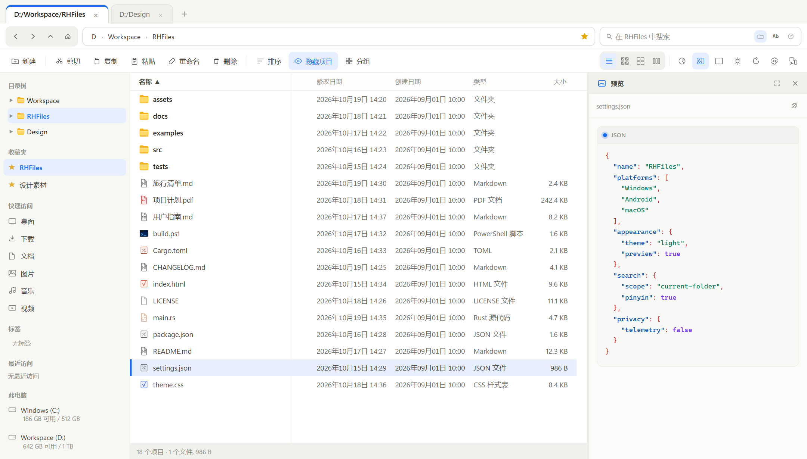
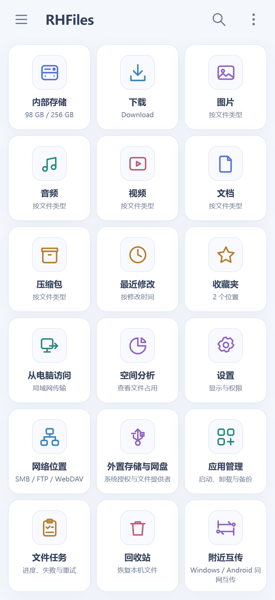
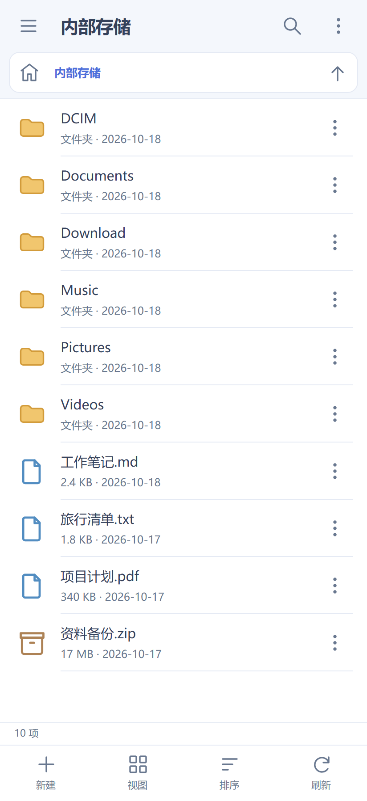
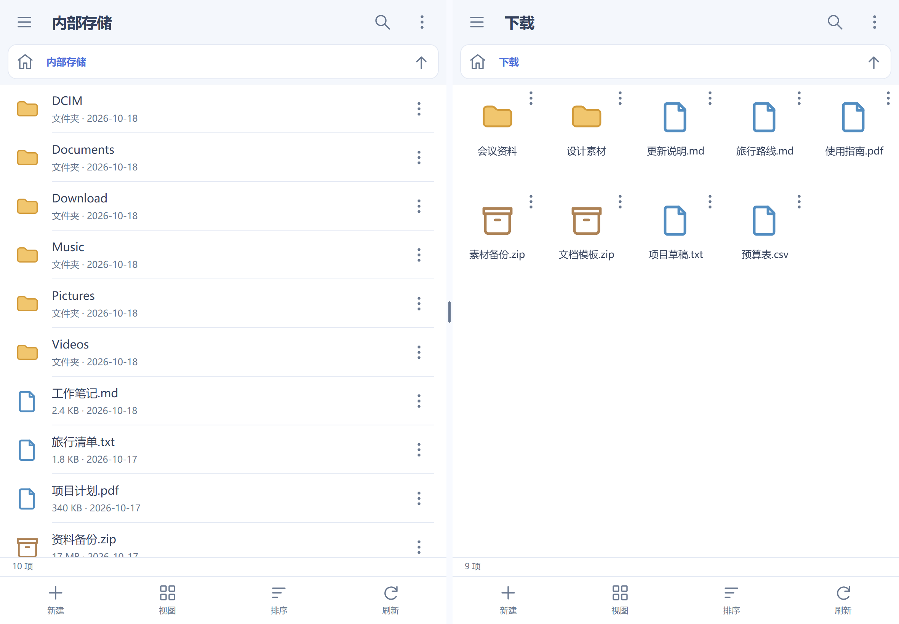

<p align="center">
  
</p>

<h1 align="center">RHFiles</h1>

<p align="center">Windows 桌面版 · Android 手机版 · macOS Apple Silicon 预览版</p>
<p align="center"><a href="#中文">中文</a> · <a href="#english">English</a></p>

## 界面预览 / Screenshots

Windows · 文件浏览与代码预览



<table>
  <tr>
    <th>Android · 首页</th>
    <th>Android · 文件浏览</th>
  </tr>
  <tr>
    <td align="center"></td>
    <td align="center"></td>
  </tr>
</table>

<details>
  <summary>Android · 展开查看大屏双窗格</summary>



</details>

<sub>截图使用示例数据，由已发布版本的界面在浏览器中渲染，不包含私人文件。</sub>

## 中文

RHFiles 是无广告、无遥测的文件管理器，提供 **Windows 桌面版与 Android 手机版**，另有 **macOS Apple Silicon 预览版**。桌面端使用 Rust / Tauri；手机版拥有面向触控、平板与折叠屏的独立界面和 Android 原生能力。各平台功能不完全相同，桌面版与 Android 的版本号独立维护。

### 下载

| 平台 | 下载入口 | 说明 |
| --- | --- | --- |
| Windows 10 / 11 | [Gitee 下载](https://gitee.com/railgunhamster/RHFiles/releases) · [GitHub portable / 安装程序](https://github.com/RailgunHamster/RHFiles/releases/latest) | 正式标签 `v…`，支持 portable 原地更新 |
| Android 7.0+ | [Gitee APK](https://gitee.com/railgunhamster/RHFiles/releases) · [GitHub Android 发布记录](https://github.com/RailgunHamster/RHFiles/releases?q=android-v) | 正式标签 `android-v…`；普通手机选择 ARM64 APK |
| macOS 12+ / Apple Silicon | [macOS 预览构建](https://github.com/RailgunHamster/RHFiles/actions/workflows/macos.yml) | 从成功的运行记录下载 `.app.zip` / `.dmg`，不提供 Intel 版本 |

GitHub 的 **Latest** 标记留给 Windows，不代表 Android 没有新版本。两个平台使用独立的更新清单与日志；已发布安装包不覆盖，修复使用新版本。详见[版本与发布规则](docs/RELEASING.md)。

### Android 手机版

- 本机存储、SD 卡、USB 与系统授权的文档提供者；所有文件访问权限由用户在 Android 设置中授予，系统受限目录不会因此解除限制。
- 图片、视频、音频、文档、压缩包与最近修改分类；图片、视频按实际文件夹分组，并显示最新媒体的缩略图。
- 触控多选、文件复制/移动/删除、文件夹合并、回收站、ZIP/TAR/GZ/XZ 压缩包相关操作与文本编辑。网络/授权位置的能力取决于协议和提供者，不与本机操作完全等同。
- 独立双窗格，可选择左右或上下布局，复制/移动到另一窗格；按内外屏、横竖屏分别记忆布局，平板宽屏可显示常驻侧栏。
- 图片缩放与滑动浏览，音视频播放、定位与相邻视频切换；设备编解码能力仍有限制，MP4 扩展名不保证其中的编码一定可播放。
- 隔离的 EPUB / MOBI 等电子书阅读器；书籍内容不获得文件管理器的系统操作接口。
- SMB、FTP、WebDAV 网络位置；SMB 可只填主机以枚举共享，支持局域网发现、编辑连接与收藏子文件夹；可直接查看网络图片和播放支持的媒体。
- 文件名索引与搜索、应用管理及 APK 备份、文件夹空间分析与详细报告；复制、移动等文件任务由后台服务执行，可查看进度、失败与中断记录。
- 向电脑提供受密码保护的 HTTP / FTP 文件服务；与 Windows 加密[附近互传](docs/NEARBY.md)，接收端逐批确认，不经过云中转。
- 本地加密配置备份，以及可选的 WebDAV 配置同步。同步收藏、网络连接等可共享配置，默认不上传登录密码，新设备需要补填。
- APK 自动更新支持 Gitee、GitHub 和家庭服务器；新安装默认 Gitee，已保存的来源保持不变。下载后验证包名、版本、签名及校验和，再由 Android 系统确认安装。

统一任务中心、外部图片打开、按类型记住打开方式和侧栏访问历史正在开发，不能把界面方案当作已发布功能。当前能力、权限、测试范围和限制见 [Android 说明](docs/ANDROID.md)。

### Windows 桌面版

- 标签页、固定与排序、独立双窗格、可配置快捷键、多选，以及可撤销的删除、重命名和不覆盖移动。
- 详细、卡片、缩略图和分栏视图，显示 Windows 文件关联图标；支持收藏、标签、Git/SVN 状态、SMB 路径、FTP/SFTP 和云文件状态。
- 默认当前文件夹搜索；可切换 Everything 全局搜索。支持中文汉字、完整拼音、首字母、文件名中段匹配、通配符与正则表达式。
- 文件夹、图片、文本/源码、Markdown、PDF、音视频、RTF、DOCX 文本、Windows 快捷方式和常见 3D 模型预览；文本带语法颜色和读取/渲染上限。
- 预览与 `dust` 空间分析互斥使用同一检查器区域，可放大预览并操作分析结果。
- 随包 7-Zip 浏览/解压 ZIP（含分卷）、7z、RAR 等格式，提供进度与取消；ZIP 创建为内置实现。
- 随包 FFmpeg 转换常见视频、音频与图片，可配置编码、质量、分辨率、码率等参数，并查看进度、速度和错误。
- 地址栏支持本地、UNC / SMB 路径及 `file:///` 地址；文件地址会打开所在目录并选中文件。
- 可选的 Windows 资源管理器与原生打开/保存框伴随列表；也能从右键菜单打开 Explorer 或定位文件。
- 主题包、每个虚拟桌面的独立数据，以及 Gitee / GitHub / 家庭服务器 Velopack portable 自更新；Windows 0.1.73 起默认使用 Gitee。

**安装：** portable 包必须完整解压，再运行 `RHFiles.exe`；保留同目录下的 `Everything.exe`、`Everything64.dll`、`dust.exe`、`ffmpeg.exe`、`7z.exe`、`7z.dll` 等文件。Windows 当前构建未进行代码签名，可能显示“未知发布者”。

**搜索与预览：** Everything 不可用时，当前文件夹搜索使用限时、限量的文件系统兜底；全局搜索需要 Everything 索引和可用的 IPC。普通账号索引全部 NTFS 卷可能需要 Everything 服务。媒体播放依赖 WebView2 / Windows 编解码器；DOCX、RTF 当前为文本型预览，不完整还原排版。离线 3D 支持 glTF/GLB（含 Draco / Meshopt）、OBJ/MTL、FBX、STL、PLY、3MF，提供旋转、缩放、平移、线框与动画；自动预览限制为 128 MiB、三百万三角面，暂不处理 CAD。

**格式转换：** 右键选择“转换格式”，任务面板显示输出大小、速度、进度、取消及 FFmpeg 错误。随包 FFmpeg 9.0.1 Essentials 可在设置中替换。先写同目录临时文件，失败或取消不覆盖已有目标，成功后才替换。

**主题与隔离：** 内置纸白、深色、暖沙、薄雾、森林和石板主题。自定义 JSON 主题包位于 `%APPDATA%\RHFiles\themes\*.json`，设置中可重新加载，见[主题文档](docs/THEMES.md)。在另一 Windows 虚拟桌面启动时使用独立实例与配置；移动已有窗口不会中途切换数据目录。额外配置位于 `%APPDATA%\RHFiles\desktops\<桌面 ID>`，WebView 缓存另存在 LocalAppData；不同 Windows 账号也独立。安装更新前需结束文件任务并退出其他桌面的实例；检查/下载不会强退它们。

**Windows 集成（实验性）：** 设置中开启后，资源管理器或标准打开/保存框旁显示 RHFiles 已打开的位置列表。点击只跳转当前目标窗口，默认快捷键 `Ctrl+G` 仅重新聚焦列表。浏览器的原生文件选择框可用，但自绘选择器和管理员权限窗口可能不支持。“用 RHFiles 选文件”提供按对话框类型过滤的缩略图网格、多选与预览，确认后写回仍打开的原生对话框；取消不影响原选择框，也不改写剪贴板。

**更新：** 启动后、打开设置时及运行期间每小时检查；关闭自动检查后仅手动检查生效。可读取累计更新日志，离线保留随包日志。Windows 专属的 Everything、Velopack、Explorer 集成和高级主题能力，不代表 Android / macOS 都具备。

**虚拟桌面识别失败：** 不再阻止启动，而使用当前账号、登录会话的独立备用配置；原有各桌面数据不会被覆盖或混用。备用配置在设置中明确标识，并暂停 Explorer / 原生选文件窗口联动。系统恢复识别后重新启动会使用正常桌面配置，不自动合并备用数据。

### macOS 预览版

支持 Apple Silicon（M 系列、arm64），与桌面源码共用版本。当前为 ad-hoc 签名、**未经 Apple 公证**的预览构建，不宣称与 Windows 功能完全一致，仍需 Mac 实机界面验收。安装、权限和平台差异见 [macOS 说明](docs/MACOS.md)。

### 开发与测试

Windows 0.1.76 / Android 0.1.25 起提供不依赖 SMB 的[局域网 HTTPS 文件服务](docs/LAN-SERVICE.md)：专用 JSON API 与 WebDAV 共用文件/权限核心，手机支持离线扫码或局域网发现后核对身份配对。默认只读，首版不覆盖已有目标。

Windows 需要 `rust-toolchain.toml` 指定的 Rust、WebView2；发布打包还需要 .NET 8 与 Velopack CLI 1.2.0。

```powershell
cargo check --workspace
cargo test --workspace --locked
npm ci --ignore-scripts
npm test
./scripts/test-gui.ps1 -Timeout 120
cargo build --release --locked --package rhfiles-tauri
./scripts/package-velopack.ps1
```

Android 需要 Android SDK / NDK、JDK 与 Rust Android target。请使用构建脚本同步原生源码、清单和签名，并验证最终 APK：

```powershell
cargo test --manifest-path android/src-tauri/Cargo.toml --lib --tests
node --test android/web/tests/*.test.cjs android/web/tests/format.test.js
./scripts/android-build.ps1 -Target aarch64
```

详见 [Android 开发与测试](android/README.md)、[macOS 构建](docs/MACOS.md)、[测试说明](docs/TESTING.md)和[发布说明](docs/RELEASING.md)。浏览器测试使用模拟 IPC，不等于真机媒体播放、系统权限或安装流程验证。

### 开源许可与第三方组件

原创代码采用标准 [Apache License 2.0](LICENSE)，版权所有者为 RailgunHamster（2026）。允许使用、修改、再分发与商用；再分发须附许可证并保留适用的版权、署名与 [NOTICE](NOTICE) 来源声明，修改文件须注明改动。署名可放在 NOTICE、源码/文档或通常的声明展示处，不强制只能放在软件界面；私人自用不要求公开声明。没有添加自定义许可条件。第三方组件遵循各自许可，不授予其名称或商标权利。

Windows portable 随附 Everything、`dust`、未修改的独立 FFmpeg 程序，以及官方 7-Zip 26.03 x64 的 `7z.exe` / `7z.dll`（LGPL 及 unRAR 限制，见 `7zip-LICENSE.txt`）。FFmpeg 构建与源码信息见随包 `FFmpeg-NOTICE.txt`、[FFmpeg 许可说明](https://ffmpeg.org/legal.html)与 [Gyan 构建](https://www.gyan.dev/ffmpeg/builds/)。离线 3D 预览使用 Three.js 0.185.1 的 MIT 许可子集。分发须保留组件许可证和声明；其他依赖记录在各平台 `Cargo.lock` 及源码中。

---

## English

RHFiles is an ad-free, telemetry-free file manager with a **Windows desktop application**, a separate **Android mobile application**, and a **macOS Apple Silicon preview**. Desktop uses Rust / Tauri; Android has its own touch-oriented interface and native platform integration. Platform features are not identical, and desktop and Android versions advance independently.

### Download

| Platform | Download | Notes |
| --- | --- | --- |
| Windows 10 / 11 | [Gitee downloads](https://gitee.com/railgunhamster/RHFiles/releases) · [GitHub portable / installer](https://github.com/RailgunHamster/RHFiles/releases/latest) | Stable tags `v…`; portable in-place updates |
| Android 7.0+ | [Gitee APKs](https://gitee.com/railgunhamster/RHFiles/releases) · [GitHub Android releases](https://github.com/RailgunHamster/RHFiles/releases?q=android-v) | Tags `android-v…`; use ARM64 for ordinary phones |
| macOS 12+ / Apple Silicon | [macOS preview artifacts](https://github.com/RailgunHamster/RHFiles/actions/workflows/macos.yml) | Download `.app.zip` / `.dmg` from a successful run; no Intel builds |

GitHub **Latest** is reserved for Windows; it does not indicate whether Android has an update. Each platform uses its own update feed and release notes. Published package bytes are immutable; corrections receive a new version. See [version and release policy](docs/RELEASING.md).

### Android

- Local, SD-card, USB and system-authorized document-provider storage. Users grant all-files access through Android settings; protected system directories remain restricted.
- Image, video, audio, document, archive and recently modified categories. Image/video albums group real folders and use their newest media as thumbnails.
- Touch multi-selection, copy/move/delete, folder merging, local trash, ZIP/TAR/GZ/XZ archive operations and text editing. Remote/provider capabilities differ from local storage.
- Independent horizontal or vertical panes with Copy/Move to Other Pane. Layout choices are remembered separately for inner/outer displays and portrait/landscape; wide layouts can keep the drawer visible.
- Image zoom/swipe browsing, media playback, seeking and adjacent-video navigation. Codec support depends on the device; an MP4 extension alone does not guarantee playback.
- An isolated EPUB / MOBI and other ebook reader; book content does not receive file-manager system APIs.
- SMB, FTP and WebDAV connections, host-only SMB share enumeration, LAN discovery, editable connections and bookmarked subfolders. Browse remote images and stream supported media directly.
- A local filename index/search, application management/APK backup, and detailed folder space reports. File operations run in background services with progress, failure and interruption records.
- Password-protected HTTP / FTP access from a computer, plus encrypted [Nearby Transfer](docs/NEARBY.md) with Windows, per-batch receiver approval and no cloud relay.
- Encrypted local configuration backups and optional WebDAV configuration sync. Shared favorites/connections sync without login passwords by default; new devices request the missing credentials.
- APK updates from Gitee, GitHub or a home server. Gitee is the default for new installations; saved choices remain unchanged. Package identity, version, signing certificate and checksum are verified before Android requests installation confirmation.

The unified task center, external image opening, remembered per-type openers and sidebar visit history are in development, not features already shipped by the interface proposal. See [Android features, permissions and limits](docs/ANDROID.md).

### Windows

- Tabs with pinning/reordering, independent dual panes, configurable shortcuts, multi-selection and undo for delete, rename and non-overwriting move operations.
- Details, Cards, Thumbnails and Columns views with Windows association icons; favorites, tags, Git/SVN status, SMB paths, FTP/SFTP and cloud-file states.
- Current-folder search by default, optional Everything global search, Chinese/Pinyin/initials and substring matching, wildcards and regular expressions.
- Bounded previews for folders, images, source/text with syntax colors, Markdown, PDF, audio/video, RTF, DOCX text, Windows shortcuts and common 3D models.
- Mutually exclusive Preview / `dust` disk-usage inspection, expandable preview and actionable usage results.
- Bundled 7-Zip for browsing/extracting ZIP (including split volumes), 7z, RAR and more, with progress/cancellation; ZIP creation remains built-in.
- Bundled FFmpeg for configurable video/audio/image conversion with progress, speed, cancellation and detailed errors.
- Local/UNC/SMB paths and `file:///` URLs; file addresses reveal and select the file in its containing folder.
- Optional File Explorer / native Open/Save dialog integration, reloadable theme packs, per-virtual-desktop profiles, and Gitee/GitHub/home-server Velopack portable updates. Windows defaults to Gitee from 0.1.73 onward.

**Installation:** extract the entire portable ZIP and run `RHFiles.exe`. Keep `Everything.exe`, `Everything64.dll`, `dust.exe`, `ffmpeg.exe`, `7z.exe`, `7z.dll` and the other bundled files beside it. Current Windows builds are not code-signed and may show an “Unknown publisher” warning.

**Search and previews:** when Everything is unavailable, folder search has a time/result-bounded filesystem fallback. Global search needs a working Everything index/IPC; standard accounts may need the Everything service for all NTFS volumes. Media playback uses WebView2/Windows codecs. DOCX/RTF previews are text-oriented, not full layout rendering. The offline 3D viewer supports glTF/GLB (Draco/Meshopt), OBJ/MTL, FBX, STL, PLY and 3MF, with orbit/zoom/pan, wireframe and animation. Automatic preview is capped at 128 MiB and three million triangles; CAD is out of scope.

**Conversion:** choose **Convert format** from the context menu. The file-operations panel shows output size, speed, progress, cancellation and FFmpeg errors. FFmpeg 9.0.1 Essentials is bundled and can be overridden in Settings. Output is staged beside the destination; cancellation/failure leaves existing files untouched, and replacement occurs only after success.

**Themes and profiles:** Paper, Dark, Sand, Mist, Forest and Slate themes are included. User JSON packs live in `%APPDATA%\RHFiles\themes\*.json` and can be reloaded; see [theme packs](docs/THEMES.md). Starting RHFiles on another Windows virtual desktop creates an independent instance/profile; moving an existing window does not change its data mid-task. Additional profiles use `%APPDATA%\RHFiles\desktops\<desktop-id>` and a separate LocalAppData WebView cache. Windows accounts are isolated too. Installing an update requires completed tasks and other desktop instances to exit; checking/downloading does not force them to exit.

**Windows integration (experimental):** an opt-in companion list beside File Explorer or standard Open/Save dialogs shows RHFiles locations. Clicking affects only the target Windows window; the default `Ctrl+G` shortcut merely refocuses the list. Native browser file pickers are supported; custom or elevated pickers may not be. **Choose files in RHFiles** offers a type-filtered thumbnail grid, multi-selection and preview, then returns selected files to the still-open native dialog. Cancellation preserves the original picker; the integration does not replace the clipboard.

**Updates:** automatic checks run after startup, on opening Settings and hourly. Disabling them leaves only manual checks. Cumulative notes are available with bundled offline history. Everything, Velopack, Explorer integration and advanced desktop themes are Windows-specific, not promises of identical Android/macOS functionality.

**Unavailable virtual-desktop identity:** startup uses an isolated account/session fallback instead of exiting. Existing desktop profiles remain untouched. Settings identifies the fallback, and Explorer/file-dialog integration is disabled there. Restarting after Windows identity detection recovers uses the normal desktop profile; fallback data is not automatically merged.

### macOS preview

Apple Silicon (M-series, arm64) builds share the desktop source version. They are ad-hoc-signed, **not Apple-notarized** previews, not a claim of Windows feature parity. GUI acceptance testing on a Mac is still needed. See [macOS setup, permissions and limits](docs/MACOS.md).

### Development and tests

Windows 0.1.76 / Android 0.1.25 add an opt-in [LAN HTTPS file service](docs/LAN-SERVICE.md): native JSON and WebDAV interfaces share one confined file/permission core, with offline QR pairing or LAN discovery plus explicit identity verification. Read-only by default, no destination overwrites in v1.

Windows needs the Rust toolchain in `rust-toolchain.toml` and WebView2; packaging additionally requires .NET 8 and Velopack CLI 1.2.0.

```powershell
cargo check --workspace
cargo test --workspace --locked
npm ci --ignore-scripts
npm test
./scripts/test-gui.ps1 -Timeout 120
cargo build --release --locked --package rhfiles-tauri
./scripts/package-velopack.ps1
```

Android needs the Android SDK/NDK, JDK and Rust Android target. Use the build helper to synchronize native sources, manifest/signing inputs and verify the APK:

```powershell
cargo test --manifest-path android/src-tauri/Cargo.toml --lib --tests
node --test android/web/tests/*.test.cjs android/web/tests/format.test.js
./scripts/android-build.ps1 -Target aarch64
```

See [Android development](android/README.md), [macOS builds](docs/MACOS.md), [testing](docs/TESTING.md) and [release instructions](docs/RELEASING.md). Browser suites mock IPC; they do not establish device codec support, permission handling or successful system installation.

### License and third-party components

Original code is under the standard [Apache License 2.0](LICENSE), copyright 2026 RailgunHamster. Use, modification and commercial redistribution are allowed subject to that license. Redistribute the license and preserve applicable copyright, attribution and [NOTICE](NOTICE) statements; identify modified files. Attribution may appear in NOTICE, accompanying source/docs or the usual notices display, rather than necessarily in the UI. Private use requires no public announcement. No custom license conditions are added; third-party components retain their own licenses and trademark rights.

Windows portable packages include Everything, `dust`, a separate unmodified FFmpeg executable, and official 7-Zip 26.03 x64 `7z.exe` / `7z.dll` (LGPL with the unRAR restriction; see `7zip-LICENSE.txt`). FFmpeg build/source information is in the bundled `FFmpeg-NOTICE.txt`, [FFmpeg legal information](https://ffmpeg.org/legal.html) and [Gyan builds](https://www.gyan.dev/ffmpeg/builds/). The offline viewer vendors an MIT-licensed subset of Three.js 0.185.1. Preserve accompanying licenses/notices; other dependencies are recorded in each platform's `Cargo.lock` and source tree.
